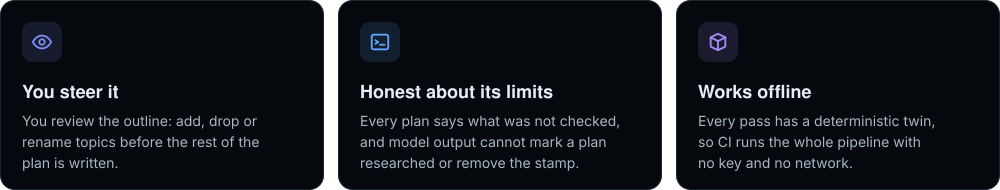

<p align="center">
  
</p>

<p align="center">
  
  
  
  <a href="#works-offline"></a>
</p>

<p align="center">
  <a href="#install"><b>Install</b></a> ·
  <a href="#commands"><b>Commands</b></a> ·
  <a href="#how-a-plan-is-made"><b>How a plan is made</b></a> ·
  <a href="#prototypes-come-later"><b>Prototypes</b></a> ·
  <a href="#status"><b>Status</b></a> ·
  <a href="#working-on-this-repo"><b>Working on this repo</b></a>
</p>

<p align="center">
  
</p>

A framework for planning ideas with agents.

Some ideas cannot be judged by building a quick version, because the unknowns are in
the territory around them: what the deeper topics are, how they depend on each other,
what could sink it, and where to begin. Give proto.pilot an idea and a little direction,
and it works that out into an organised set of text plans.

```bash
proto plan "open a small bakery that only sells sourdough" --direction "one person, rented kitchen" --depth shallow
```

```
  pass scope...
  pass outline...
Open a small bakery that only sells sourdough
  constraint: Rented kitchen — no owned or dedicated premises; access is on someone else's terms
  constraint: Sourdough only — a single product category, with no other baked goods as a hedge
  open question: Is this meant to replace a full-time income, or to run alongside other work?
  depth: shallow (4 topics)
  topics:
    1. The fermentation clock vs. booked kitchen hours
    2. Kitchen terms and who holds the obligations
    3. What a loaf must earn, and how it reaches a buyer
    4. Testing demand cheaply, and the conditions to stop
Estimated model calls: 5 in all, 3 still to come (connect, consider, start).

Write this plan? Enter accepts, or: add TITLE | drop N | rename N TITLE | quit:

  pass connect...
  pass consider...
  pass start...
  pass render...
Not researched: nothing here was checked against a source.

Plan at open_small_bakery_that. Start with PLAN.md.
```

That is a real run, shortened. You get a folder:

```
PLAN.md              the idea, the topic map, how topics connect, where to start
topics/<topic>.md    one text plan per topic: why it matters, risks, unknowns, decisions
dreams.md            extensions of the idea, kept apart from the plan (not built yet)
sources.md           what research relied on (not built yet)
```

The links between topics are data, not prose, and they decide where the plan starts.
In that run the bakery's first step was the kitchen's access terms, because every other
topic depends on them and they are the one thing that could return a flat no. The bread
comes second.

A plan is not a finished answer. It is the cheapest way to see the shape of an idea
before spending anything on it, and it is what a prototype should be built from later.

## Install

```bash
git clone https://github.com/skyrowlabs/proto-pilot && cd proto-pilot
python -m venv .venv && . .venv/bin/activate
pip install -e ".[dev]"
proto doctor          # what each target needs, the SDK, credentials, a port
```


The virtualenv is not optional advice — on a distro whose Python is externally
managed (Arch, and Debian since 3.11) a bare `pip install -e .` refuses to run.

Needs Python 3.11 or newer and Claude credentials: either `ANTHROPIC_API_KEY`, or a
Claude subscription through the Claude Code CLI. The API is the default, and the tool
never falls back from one to the other by itself, because they bill differently. To use
a subscription, pass `--backend claude-code` or set `PROTOPILOT_LLM=claude-code`.

Planning needs nothing else. Docker is only for `proto new --target web`.

## Commands

| | |
|---|---|
| `proto plan IDEA` | scope it, outline it with you, connect the topics, weigh the risks, pick first steps, write the folder |
| `proto doctor` | why it will not work here |

Useful flags on `plan`: `--direction` (scope, emphasis, constraints), `--depth`
(`shallow`, `standard` or `deep`: 4, 6 or 8 topics), `--dir`, `--backend`, `--offline`
(no API calls, see below), `--yes` (skip the questions and the review).

Off a terminal, `--yes` is required, so a script is refused rather than left waiting.
Run on a folder that already holds a plan for the same idea and direction, it redraws
the pages from the plan and calls no model.

**Rendered pages are not for editing.** The plan is stored as data in the folder, every
page is drawn from it, and a re-render overwrites them.

The prototype commands are under [Prototypes come later](#prototypes-come-later).

## How a plan is made

| Pass | Produces | |
|---|---|---|
| `scope` | goal, constraints, up to three questions for you | built |
| `outline` | the topics, each with a reason it matters | built, and **you review it** |
| `research` | findings per topic, each cited or labelled an assumption | coming |
| `connect` | typed links: `depends-on`, `informs`, `conflicts-with` | built |
| `consider` | per topic: risks, unknowns, decisions someone must make | built |
| `start` | the first few steps, each with its reason | built |
| `dream` | extensions of the idea, collected, evaluated and proposed | coming |
| `verify` | structural checks, with a bounded repair | coming |
| render | every page | built, no model call |

**The review sits at the outline** because that is the last cheap place to fix a
misreading. A topic list can be read in thirty seconds and a finished document cannot.
Add, drop or rename topics there before the rest is written.

**Where to start is checked, not just written.** The first step must have no unmet
dependency and each later step must follow what it depends on. A plan that breaks that
is refused, not written. So is one naming a topic that does not exist, or one where every
topic waits on another.

**Model output is data, not authority.** A pass can only fill the fields it owns. It
cannot mark a plan researched, add a source or remove the stamp, and the only model text
that reaches a file name is a checked slug.

**Nothing is written until every model pass has worked.** A failed run leaves no folder,
so a rerun starts over from `scope`, and review edits are lost.

### What a plan does not know yet

Nothing is researched today, so every plan is stamped **Not researched** and has no
sourced findings. Treat what it says as a well-organised set of questions and reasoning,
not as facts. Only the prompt stops a model stating a fact inside a risk or a reason, and
the stamp is there for that.

Three things are next, in [the plan for this work](docs/TODO/plan-prototypes.md):

- **A verifier**, to prove a plan is coherent and traceable. It will never prove a plan
  true, and its green line will say so.
- **Dreaming**, because every pass here narrows. It collects lighter extensions of the
  idea through fixed lenses, scores them in a separate call, and keeps them in their own
  file so a guess can never read as a finding. Only a person promotes one into the plan.
- **Research**, one call per topic, with every source retrieved during the run.

## Works offline

Every plan pass has two implementations: a prompt and a deterministic twin. `--offline`
runs the second: no API calls and no key, a generic topic skeleton with every finding
labelled an assumption, byte-identical on every run.

It is what the test suite runs, so the whole pipeline is exercised on every commit. A
pipeline that can only be tested with a network call and a credit card stops being
tested.

## Prototypes come later

proto.pilot started as a tool that turned an idea into a running app. That still works
and gets upkeep, but no new features: a prototype is worth more once an idea is concrete
enough to give agents something to build, and a plan is how it gets there.
[`docs/ideas/plans-first.md`](docs/ideas/plans-first.md) has the reasoning, and a later
step is to build a prototype from one topic of a plan.

```bash
proto new "a shared list of who has borrowed which tool" --direction "make it feel like a ledger"
```

It writes a small spec, shows it to you, generates the app, then boots and drives it
rather than assuming it works. Red gets a bounded repair loop, and if that fails the tree
comes back with a `RUNBOOK.md` saying what is broken. The result is something to look at
and throw away, not a starting point for production. The default is a Textual and SQLite
app in your terminal. `--target web` gives you FastAPI and Postgres in Docker, and needs
Docker with Compose v2.

| | |
|---|---|
| `proto new IDEA` | generate, boot, verify, hand it back |
| `proto add CHANGE` | amend the spec, regenerate, re-verify |
| `proto up` / `down` / `logs` / `test` | run a `--target web` prototype; a terminal one uses `make run` |
| `proto spec` | what this project actually promised |
| `proto archetypes` | what shapes this build can generate, and what each asks |
| `proto targets` | what media it can generate into, and what each can build |
| `proto ls` | every prototype on this machine, and which are running |
| `proto rm` | delete one: containers, data and the tree |
| `proto prune` | forget registry entries whose directory is gone |
| `proto gc` | collect Docker resources a deleted tree left behind |

Three optional extras: `dev` pulls the web target's stack, `browser` adds Playwright (without
it the web target's browser stage is reported as skipped, never as green), and `web` is
the front end behind `proto serve`.

Known gaps: `auth: "password"` is accepted by the spec and built by no pass, and `jobs`
and `external_apis` are recorded and otherwise ignored.

How it all works, including what a target owns and why the model can write so few paths,
is in [`docs/ARCHITECTURE.md`](docs/ARCHITECTURE.md#how-a-prototype-is-built).

## Testing

```bash
./pp test unit          # or: python -m pytest -q
```

The unit suite needs no key, no network and no Docker daemon. Plans are tested through
their offline twins and a fake model, with hostile model output as a first-class case.
Prototypes are tested by generating a tree and running that tree's own smoke suite, with
Docker and the API faked (`tests/fakes.py`) for the verify and repair loops.

## Model usage

Claude Opus 5, adaptive thinking, `effort: high`, structured output against a JSON Schema
per pass. Override with `PROTOPILOT_MODEL` / `PROTOPILOT_EFFORT`.

## Status

**The direction changed on 2026-11-06:** planning is the product, and prototyping waits
until a plan is concrete enough to feed it.

Early, and honest about it. `proto plan` runs against a real model today and writes a
real plan, with no research, dreaming or verification yet. `NOTES.md` is the live parking
lot: open items, what got resolved, and what is worth doing next.

## Working on this repo

Two command-line tools live here and they are deliberately not the same thing.
**`proto` is the product** — installed onto your PATH, run from wherever you
want a plan. **`./pp` is this repository's own tooling** — its gates,
generators and scheduled jobs, run from the repo root and never shipped to a
user. One `--help` serving a person planning an idea and a person maintaining
the tool would serve neither.

The repo shell is generated by **skeletor** — a sibling checkout, not part of
this repository — at the `agentic` tier;
`.skeletor.json` records exactly how, and `bin/skeletor-upgrade` carries
template changes in. That means the docs lifecycle, the rules in `docs/rules/`,
the marker-based test suites and the scheduled-job machinery are not local
inventions — they are one shared shell, debugged once.

```bash
python -m venv .venv && .venv/bin/pip install -r scripts/requirements.txt && .venv/bin/python scripts/install_project.py
.venv/bin/pre-commit install --install-hooks && .venv/bin/python scripts/git/install_merge_drivers.py
./pp check pre-push      # every CI gate this host can run
./pp test unit           # the fast suite
```

`check pre-push` is not quite everything CI blocks on, and the gap is named
rather than implied: the **integration suite** needs the stack up, so it runs on
CI only. `tests/test_pre_push_covers_ci.py` recomputes both sets — the gates in
`ci.yml` and the gates in `pp check pre-push` — and fails when one appears in
neither, so this sentence cannot quietly go stale. It said "everything" until
2026-09-06, when it was measurably false: two gates CI blocks on and this host
runs fine were missing from the bundle, and the word stopped anyone looking.

[`AGENTS.md`](AGENTS.md) is the rules — read it before changing anything.
[`docs/README.md`](docs/README.md) indexes the rest;
[`.github/DOCS_INDEX.md`](.github/DOCS_INDEX.md) is the routing table an agent
reads so it loads two documents instead of all of them.

## Licence

[MIT](LICENSE) © SKYROW LABS LLC
